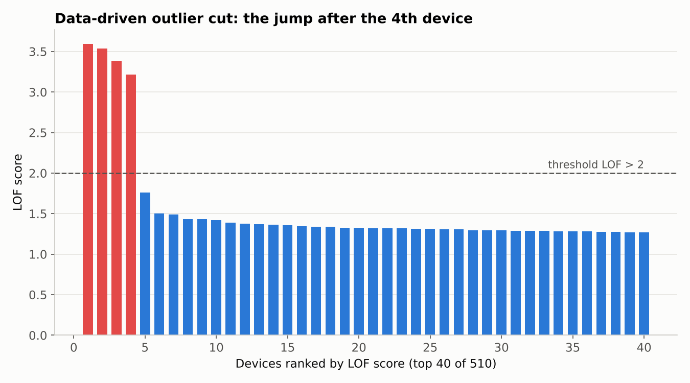
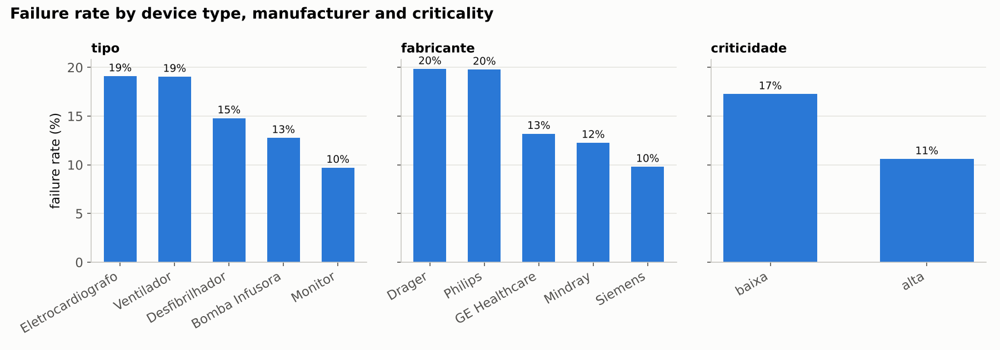

# Hospital Equipment Failure Prediction (CRISP-DM)

An end-to-end project to predict failures in hospital medical devices from inventory and sensor data. Built in **Altair AI Studio** and reproduced in **Python (pandas + scikit-learn)**.

| Part | CRISP-DM phase | Status |
|---|---|---|
| **1. Data Preparation** | Data understanding + data preparation | ✅ Done (this page) |
| **2. Modelling & Evaluation** | Modelling + evaluation | 🔜 Coming soon |

> Coursework for *Aprendizagem e Extração do Conhecimento* (Knowledge Learning and Extraction), MSc in Biomedical Engineering – Medical Informatics, University of Minho (2026/27).
> Author: **Renato Murayama**, physiotherapist moving into health data and medical informatics.



---

## Part 1 – Data Preparation

### The problem

A hospital **clinical engineering** department wants to predict which medical devices are about to fail (defibrillators, ventilators, monitors, infusion pumps, ECGs), so it can schedule preventive maintenance before a critical device stops working.

The data comes from two related tables:

| File | Granularity | Content |
|---|---|---|
| `equipamentos.csv` | 1 row per device | type, manufacturer, ward, installation year, daily use, temperature, energy use, costs, criticality, **failure (target)** |
| `leituras.csv` | 1–4 rows per device | periodic sensor readings: pressure, motor RPM, current, noise |

This project covers **CRISP-DM phase 3, Data Preparation**: turning two messy tables into **one clean, integrated, model-ready dataset**.

### Results at a glance

| | Before | After |
|---|---|---|
| Devices | 540 rows (30 duplicates) | **506 unique devices** |
| Tables | 2, with different granularity | **1 integrated table** (17 attributes) |
| Inconsistent categories | 5 spellings of `criticidade`, 4 of `em_uso` | 2 values each |
| Impossible values | 21 (e.g. year 2099, 48 h/day, −15 °C, 1500 dB) | 0 |
| Missing values | up to 10.2% per attribute | 0 |
| Outliers | 4 corrupted records | removed with a data-driven LOF cut |
| Failure rate (target) | | 15.0% (imbalanced classes) |

### Pipeline

```
equipamentos.csv ─► remove duplicates ─► normalise categories ─► impossible → missing ─► impute
                    (median if skewed) ─► feature engineering ─► z-score ─► LOF outliers ─┐
                                                                                         ├─► left join ─► impute ─► final CSV
leituras.csv ─────► drop ids/dates ─► impossible → missing ─► aggregate (mean per device) ─┘
```

| Step | What was done | Why |
|---|---|---|
| 01 | Removed 30 exact duplicate devices; dropped `id_leitura` and `data_leitura` | Duplicates would weigh double and leak between train and test |
| 02 | Unified `Alta/ALTA/alta` and `Sim/sim` | To an algorithm, each spelling is a different category |
| 03 | Flagged **impossible** values as missing, but kept **extreme yet plausible** ones | Keeping the rest of the record, including the target, is better than deleting the row |
| 04 | Median imputation for skewed attributes (skew ≈ 1.5), mean for symmetric ones; sensor readings not imputed before aggregation | The median is robust to the long right tail |
| 05 | `custo_manutencao_eur = parts + labour` | Less redundancy, more interpretable |
| 06 | z-transformation of the numeric device attributes | Distance-based methods (LOF) would otherwise be dominated by euros |
| 07 | **LOF with a data-driven threshold** (score > 2) instead of a fixed "top 10" | The fixed default flagged 6 normal devices just to fill the quota |
| 08 | Aggregated readings per device, then a **left join**; orphan device `EQ9999` discarded | Resolves the granularity mismatch and protects referential integrity |
| 09 | Exported the dataset; the whole flow is grouped in one reusable AI Studio sub-process | Reproducibility |

A full decision log, with the numbers behind each choice, is in [`docs/data_preparation_decisions.md`](docs/data_preparation_decisions.md).

### Highlights: where domain knowledge mattered

**1. The four "outliers" were corrupted records, not overheating devices.**
The LOF score drops sharply after the 4th device (see the chart above). Those 4 devices combine near-continuous use (22–24 h/day), ~60 °C and ~10–12 kWh. Clinical engineering context points to **record errors**:
- two are **defibrillators**, which sit in standby most of the time, so 22 h/day of active use is not credible;
- one is flagged **"not in use"** while logging 22.2 h/day, a logical contradiction;
- **none of them failed**, which you would not expect from real overheating.

**2. Labels must stay out of outlier detection.**
When `avaria` (failure) was left as a regular attribute, the distance-based method flagged 2 failed devices as outliers, which would have deleted the minority class the model needs to learn. Setting it as the *label* removed the problem.

**3. An honest early signal.**
Numeric attributes barely differ between failed and non-failed devices (all correlations with the target are below 0.1). Device type, manufacturer and criticality show larger differences, and high-criticality devices fail *less* (11% vs 17%), possibly because they get stricter preventive maintenance. Expect a modest model, and evaluate with recall, F1 and AUC using stratified cross-validation.



## Repository structure

```
├── data/
│   ├── raw/                        # original synthetic datasets (course material)
│   └── processed/                  # final dataset, z-score parameters, step-by-step log
├── src/prepare_data.py             # Python reproduction of the full pipeline
├── figures/                        # charts generated by the script
├── aistudio/                       # Altair AI Studio process (.rmp)
└── docs/
    ├── data_preparation_decisions.md
    ├── aistudio_screenshots/
    └── FE02_Relatorio_Renato_Murayama.docx   # full course report (Portuguese)
```

## How to run

```bash
python -m venv .venv
# Windows: .venv\Scripts\activate   |   macOS/Linux: source .venv/bin/activate
pip install -r requirements.txt
python src/prepare_data.py
```

The script prints a log of every step and writes `data/processed/equipment_dataset_final.csv` (506 × 17, no missing values) and the charts in `figures/`.

> **Note on LOF scores:** scikit-learn and AI Studio compute LOF slightly differently, so the absolute scores differ (top four: ~3.2–3.6 in Python vs ~2.4–2.5 in AI Studio). Both show the same jump after the 4th device and flag the **same 4 devices**.

## Tools

Altair AI Studio 2026.1 · Python 3.12 · pandas · NumPy · scikit-learn · matplotlib

## Next: Part 2 – Modelling & Evaluation

Coming soon: decision tree, Naive Bayes and Random Forest with stratified 10-fold cross-validation, evaluated mainly on **recall**, because missing a failure on an ICU ventilator costs far more than a false alarm.

## Data

The datasets are **synthetic**. They were generated artificially by the course instructors of *Aprendizagem e Extração do Conhecimento* (University of Minho) for teaching purposes. They contain **no real hospital, device or patient data**.

---

*Renato Murayama · [GitHub](https://github.com/RenatoMurayama)*
